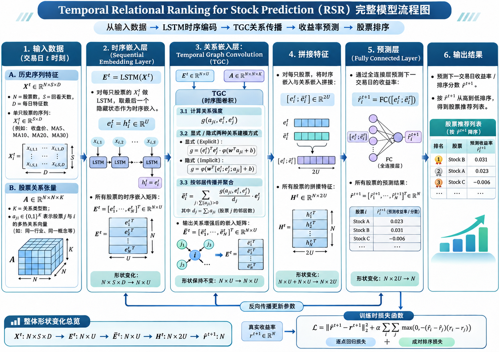
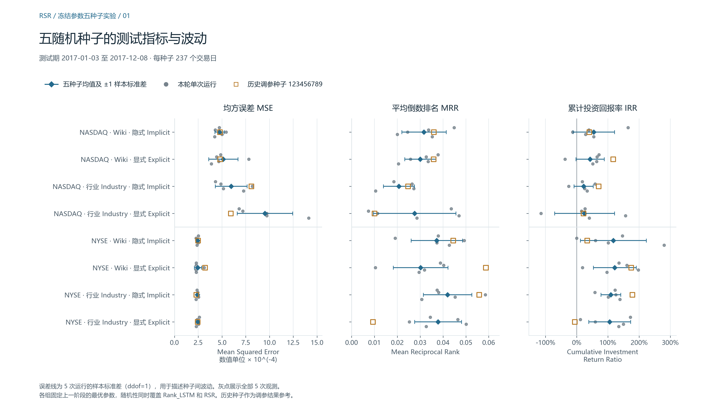

# Relational Stock Ranking — a reproduction study

[简体中文](README.zh-CN.md) · [Research Note](docs/RESEARCH_NOTE.md) · [Reproduce the workflow](docs/REPRODUCING.md)

Can company relationships help rank stocks by next-day return? This undergraduate reproduction study examines how Feng et al.’s Relational Stock Ranking (RSR) model combines price histories with company relationships, and how closely the released implementation reproduces the paper’s results. It also examines how the test results vary across seeds and trading days under a separately documented protocol. [Original paper, ACM TOIS 2019](https://doi.org/10.1145/3309547)

## Model

A shared LSTM encodes a window of closing prices and 5-, 10-, 20-, and 30-day moving averages for each stock. Temporal Graph Convolution uses those embeddings and the relation tensor to compute day-dependent propagation weights on the industry or Wikidata graph. **RSR_E** uses an embedding dot product times a learned relation score. **RSR_I** learns the relation score from endpoint embeddings and relation features. The prediction head uses both the original and propagated embeddings. The objective combines squared return error and a pairwise penalty for reversed rankings. [Paper §§3–4](https://arxiv.org/abs/1809.09441v2) · [Mathematics and implementation](docs/RESEARCH_NOTE.md#2-model-architecture-and-mathematical-reading)

Paper-level architecture diagram (Chinese)

The diagram illustrates the paper’s framework. The Research Note describes the released code’s column-wise softmax, implicit scoring and price-to-return head. The local runs use a pretrained encoder followed by a separate relation stage.

## Reproduction scope and protocols

The study covers eight RSR configurations: two markets (NASDAQ and NYSE), two relation graphs (Industry and Wikidata), and two scoring variants (RSR_I and RSR_E). The author-supplied universe contains 1,026 NASDAQ and 1,737 NYSE stocks. Both markets have 756 training days (2013–2015), 252 validation days (2016) and 237 test days (2017). [Dataset audit](audit/author-data-verification.json)

| Protocol | Design | Evidence |
| --- | --- | --- |
| A · Released workflow | Eight runs using the published seed 123456789 and supplied embeddings. Two configurations follow the author README. Six use the corresponding market’s README hyperparameters. | [Run manifest](experiments/manifest.json) · [Paper comparison](audit/public-seed-comparison.json) |
| B · Independent evaluation | Training-only scaling and training-window boundaries. One-factor searches over window length, hidden size and ranking weight, followed by six new parameter combinations. Settings were frozen before test evaluation and then used to retrain both stages with five new seeds. | [Selection and results](docs/EXPERIMENT_RESULTS.md) · [Frozen settings](runs/frozen-test-manifest.json) · [Five-seed analysis](runs/multiseed-analysis.json) |

Both protocols use a one-day horizon, Adam at 0.001 and 50 epochs per fit. Protocol B selects the lowest validation-loss checkpoint in each fit and ranks candidate settings by validation IRR at that checkpoint. The record contains 174 completed fits, including 48 Rank_LSTM fits and 126 RSR fits. The frozen evaluation between selection and five-seed retraining was inference only. Coverage is limited to the eight RSR configurations, with Rank_LSTM used as an encoder. [Experiment index](experiments/README.md)

## Results

**Protocol A achieved partial numerical reproduction.** Across eight runs, the largest relative deviation from the corresponding paper mean was 3.23% for test mean squared error (MSE). For the two README configurations, local versus paper test IRR was 95.65% versus 119% (NASDAQ Wikidata RSR_I) and 147.79% versus 106% (NYSE Industry RSR_I). The paper values summarize five runs and the local values are single runs. The full author seed list, the pretraining seeds and six configuration-specific settings remain unknown. [Eight-way comparison](audit/public-seed-comparison.json) · [Comparison figure](figures/public-seed/01-test-metrics.png)

**Protocol B showed substantial seed and date sensitivity.** The five new seeds gave 36 positive test IRRs out of 40 RSR runs. The four negative runs all used seed 1846380228 on NASDAQ. For NYSE Industry RSR_I, mean test IRR was **109.16%** (sample SD **31.47 percentage points**) and fell to **−17.45%** after excluding two fixed dates on which all five runs selected TWO. Matching seeds yielded mixed implicit-versus-explicit results. [Per-seed analysis](runs/multiseed-analysis.json) · [Event sensitivity figure](figures/multiseed/03-event-day-sensitivity.png)

*Protocol B test results. Bars show ±1 sample standard deviation across the five new seeds. The orange squares show the earlier Protocol B tuning seed for reference. MSE measures return error across eligible stock-days, MRR measures the realized rank of the daily top pick, and IRR is the sum of its daily simple returns.*

The test statistics describe one historical market window, a retrospectively filtered universe and static relation graphs. The simulated strategy assumes execution at the closing price and omits trading costs. The study does not yet cover the complete baseline, ablation or trading-strategy comparisons in the paper. [Detailed findings and scope](docs/RESEARCH_NOTE.md)

## Reproduce and inspect

Use Python 3.11.18, TensorFlow 2.21.0 and the locked WSL2 GPU environment for compatibility checks. The archived summaries and figures can be inspected directly, and the local log viewer uses the Python standard library.

~~~bash
git clone https://github.com/jinglangqiu-hub/rsr-reproduction.git
cd rsr-reproduction
python tools/monitor_training.py
~~~

Open [the local monitor](http://127.0.0.1:8766/?view=parameters&batch=6) after starting the viewer. To restore author inputs, initialize the pinned submodule and follow the environment and data guide. The Release contains predictions, checkpoints and evaluation caches with SHA-256 checks. Large generated embeddings require separate recovery for the complete local audit. [Setup and checks](docs/REPRODUCING.md) · [Artifact inventory](docs/DATA_AND_ARTIFACTS.md) · [Release](https://github.com/jinglangqiu-hub/rsr-reproduction/releases/tag/v0.1.0-experiments)

## Research Note and attribution

The notes trace the paper’s mathematical design through the implementation, the two protocols and the limits of the observed results. [English](docs/RESEARCH_NOTE.md) · [简体中文](docs/RESEARCH_NOTE.zh-CN.md) · [Evidence and figure index](docs/README.md)

RSR and Temporal Graph Convolution are from **Fuli Feng, Xiangnan He, Xiang Wang, Cheng Luo, Yiqun Liu and Tat-Seng Chua**. The reproduction project contributes a compatibility port, experiment tooling and analyses of the recorded runs. The author implementation is pinned at cfbb01bdf194b81bc5893a1b37aff1c0d0d2a82d. [Pinned upstream](https://github.com/fulifeng/Temporal_Relational_Stock_Ranking/tree/cfbb01bdf194b81bc5893a1b37aff1c0d0d2a82d) · [BibTeX](CITATION.bib) · [Modification notice](THIRD_PARTY_NOTICES.md) · [GNU AGPL v3](LICENSE)
