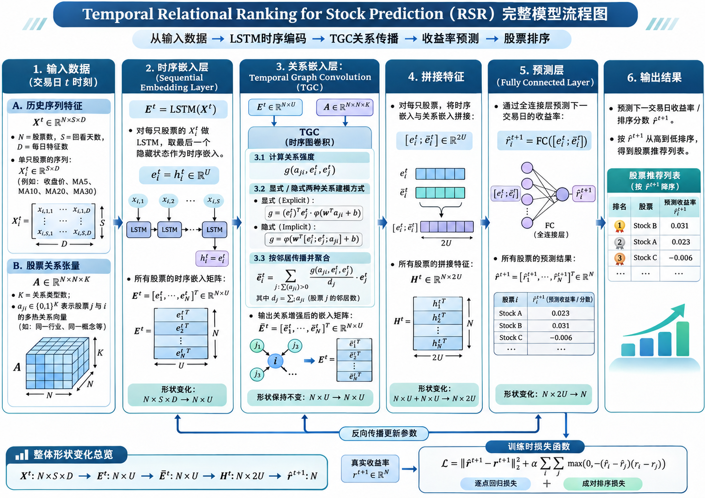
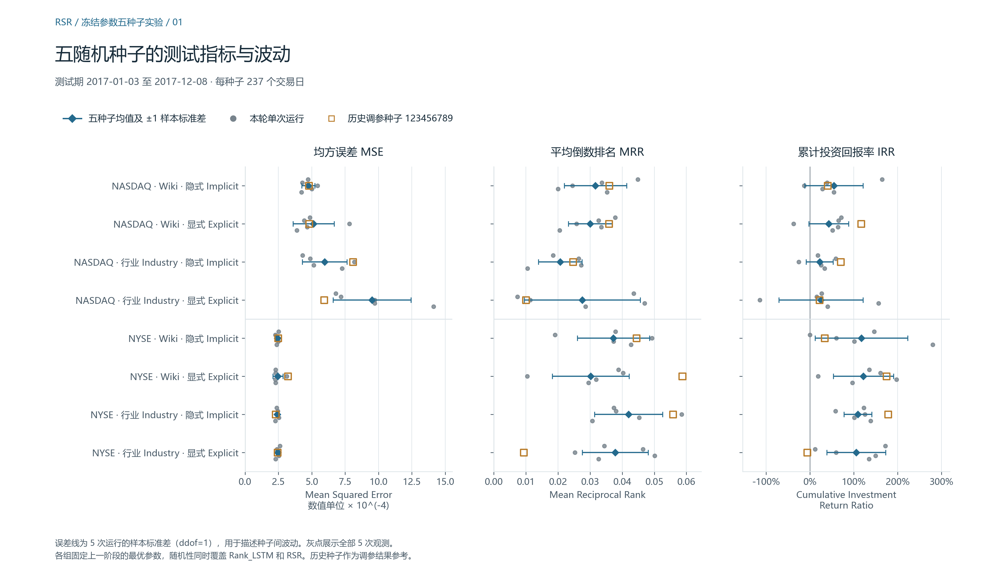

# 关系股票排序（RSR）论文复现

[English](README.md) · [中文研究笔记](docs/RESEARCH_NOTE.zh-CN.md) · [环境与数据恢复](docs/REPRODUCING.zh-CN.md)

企业关系能否帮助模型按次日收益率排序？本项目是一次本科科研复现实践，考察 Feng 等人的关系股票排序模型如何结合价格序列与企业关系，以及公开代码能在多大程度上复现论文结果。项目还以单独记录的实验协议考察了结果对随机种子和交易日期的敏感性。 [原论文，ACM TOIS 2019](https://doi.org/10.1145/3309547)

## 模型

共享 LSTM 将每只股票的历史收盘价、5／10／20／30 日移动平均编码成时序嵌入。时序图卷积结合嵌入和关系张量，在行业或 Wikidata 图上生成随日期变化的传播权重。**RSR_E** 将嵌入内积乘以学习得到的关系分数，**RSR_I** 从两端嵌入和关系特征学习分数。预测层结合原始与传播后嵌入，训练目标同时惩罚收益预测误差与成对排序颠倒。 [论文第 3–4 节](https://arxiv.org/abs/1809.09441v2) · [数学与代码对照](docs/RESEARCH_NOTE.zh-CN.md#2-模型结构与数学理解)

展开论文框架流程图

该图展示论文框架。发布代码的列方向 softmax、隐式关系评分和价格到收益率的转换见研究笔记。本地运行先取得编码器嵌入，再单独训练关系阶段。

## 复现范围与实验协议

八组 RSR 配置由 NASDAQ／NYSE、Industry／Wikidata、RSR_I／RSR_E 组合而成。作者数据包含 NASDAQ 1,026 只、NYSE 1,737 只股票。两个市场均有训练期 756 日（2013–2015）、验证期 252 日（2016）和测试期 237 日（2017）。 [数据核验](audit/author-data-verification.json)

| 协议 | 实验设计 | 证据 |
| --- | --- | --- |
| A · 作者公开流程 | 使用公开种子 123456789 和公开嵌入训练八组。其中两组采用作者 README 配置，六组沿用相应市场 README 的超参数。 | [运行清单](experiments/manifest.json) · [论文对照](audit/public-seed-comparison.json) |
| B · 独立评估 | 使用训练期归一化和训练窗口边界。独立搜索序列长度、隐藏维度和排序权重，补跑六个新组合。冻结配置后评估测试集，再用五个新种子重训两个阶段。 | [选参与结果](docs/EXPERIMENT_RESULTS.md) · [冻结配置](runs/frozen-test-manifest.json) · [五种子分析](runs/multiseed-analysis.json) |

两套协议均采用一步预测、Adam 学习率 0.001，每次训练 50 轮。协议 B 为每次训练选择验证总损失最低的检查点，再按该点的验证 IRR 选择配置。共记录 174 次完整训练，包括 48 次 Rank_LSTM 和 126 次 RSR。选参与五种子重训之间的冻结评估只做推理。当前范围为八组 RSR，Rank_LSTM 用作编码器。 [实验入口](experiments/README.md)

## 结果

**协议 A 实现了部分数值复现。** 八组测试均方误差（MSE）相对论文对应均值的最大偏差为 3.23%。两组 README 配置的本地与论文测试 IRR 分别为 95.65% 对 119%（NASDAQ Wikidata RSR_I）、147.79% 对 106%（NYSE Industry RSR_I）。论文数字来自五次运行，本地每组一次。作者完整种子列表、预训练种子及六组专属配置仍不明确。 [八组对照](audit/public-seed-comparison.json) · [对照图](figures/public-seed/01-test-metrics.png)

**协议 B 显示出明显的种子和日期敏感性。** 五个新种子的 40 次 RSR 测试中，36 次 IRR 为正。四次负值均来自 NASDAQ 的种子 1846380228。NYSE Industry RSR_I 的平均测试 IRR 为 **109.16%**（样本标准差 **31.47 个百分点**）。五次运行都在两个固定日期选中 TWO，剔除这两日后均值降至 **−17.45%**。按种子配对时，显式和隐式配置互有胜负。 [逐种子分析](runs/multiseed-analysis.json) · [日期敏感性图](figures/multiseed/03-event-day-sensitivity.png)

*协议 B 测试结果。误差线为五个新种子的 ±1 样本标准差。橙色方框为此前协议 B 的调参种子，仅供参照。MSE 衡量有效股票日上的收益预测误差，MRR 衡量每日首选股票的真实排名，IRR 累加该股票的每日简单收益率。*

这些统计对应同一历史测试期、全期筛选的股票池和静态关系图。模拟假定可按收盘价成交，未计交易成本。论文中完整的基线、关系消融及交易策略对照仍待复现。 [完整分析与范围](docs/RESEARCH_NOTE.zh-CN.md)

## 恢复与查看

兼容性验证使用 Python 3.11.18、TensorFlow 2.21.0 和锁定依赖的 WSL2 GPU 环境。已归档的汇总与图表可直接阅读，日志浏览器仅需 Python 标准库。

~~~bash
git clone https://github.com/jinglangqiu-hub/rsr-reproduction.git
cd rsr-reproduction
python tools/monitor_training.py
~~~

启动后打开[本地监测页](http://127.0.0.1:8766/?view=parameters&batch=6)。恢复作者输入时，初始化固定子模块并按环境与数据指南操作。Release 提供预测、检查点、评估缓存和 SHA-256 核验。完整重做本地审计还需另行恢复大型生成嵌入。 [环境与核验](docs/REPRODUCING.zh-CN.md) · [产物范围](docs/DATA_AND_ARTIFACTS.md) · [Release](https://github.com/jinglangqiu-hub/rsr-reproduction/releases/tag/v0.1.0-experiments)

## 研究笔记与引用

研究笔记从数学设计追踪到发布实现、两套实验协议和观察结论的适用范围。 [中文版](docs/RESEARCH_NOTE.zh-CN.md) · [English](docs/RESEARCH_NOTE.md) · [证据与图表索引](docs/README.md)

RSR 和时序图卷积由 **Fuli Feng、Xiangnan He、Xiang Wang、Cheng Luo、Yiqun Liu 和 Tat-Seng Chua** 提出。本项目的工作包括兼容适配、实验工具和对已有运行的分析。作者实现固定在 cfbb01bdf194b81bc5893a1b37aff1c0d0d2a82d。 [固定上游](https://github.com/fulifeng/Temporal_Relational_Stock_Ranking/tree/cfbb01bdf194b81bc5893a1b37aff1c0d0d2a82d) · [BibTeX](CITATION.bib) · [修改声明](THIRD_PARTY_NOTICES.md) · [GNU AGPL v3](LICENSE)
