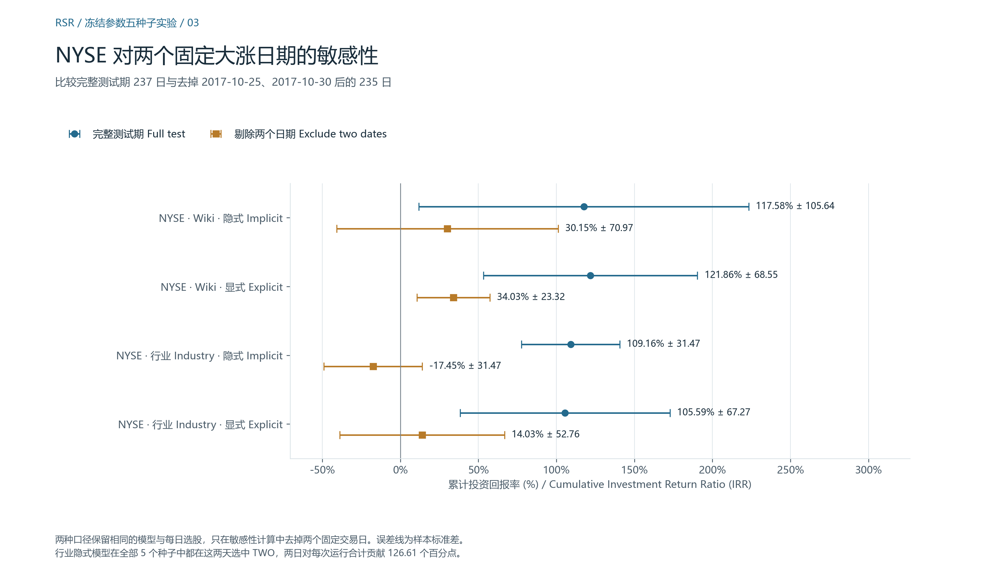

# Research Note · Temporal Relational Ranking for Stock Prediction

[简体中文](RESEARCH_NOTE.zh-CN.md) · [Project home](../README.md) · [Evidence index](README.md)

Fuli Feng, Xiangnan He, Xiang Wang, Cheng Luo, Yiqun Liu and Tat-Seng Chua proposed RSR and Temporal Graph Convolution (TGC) and reported the original experiments in *ACM Transactions on Information Systems* 37(2), Article 27, 2019. Equation and section numbers here follow arXiv v2. The reproduction evidence comes from the pinned author implementation, its local TensorFlow port and the archived experiments. [Journal article](https://doi.org/10.1145/3309547) · [arXiv v2](https://arxiv.org/abs/1809.09441v2) · [Pinned author commit](https://github.com/fulifeng/Temporal_Relational_Stock_Ranking/tree/cfbb01bdf194b81bc5893a1b37aff1c0d0d2a82d)

## 1. Motivation and problem formulation

At the close of day $t$, the task is to rank $N$ stocks by their next trading day’s return. With closing price $p_{i,t}$, the label is $r_{i,t+1}=(p_{i,t+1}-p_{i,t})/p_{i,t}$. The same number serves as a regression target and determines the realized cross-sectional order. A small error averaged across stocks can still change the top pick when predicted returns are close. The ranking objective addresses ordering directly, while regression anchors the scores to the scale of returns.

An independent time-series model can use each stock’s history. Industry membership or a business relationship gives a reason to consider another firm’s current state as well. The benchmark asks whether those links improve the ranking. A link can carry different weight on different dates even when the recorded graph remains fixed. [Paper §§1 and 3](https://arxiv.org/abs/1809.09441v2)

## 2. Model architecture and mathematical reading

### Price windows and sequential encoding

For stock $i$, the input is the last $S$ trading days through $t$. Each day supplies $D=5$ features in the order MA5, MA10, MA20, MA30 and close. The preprocessor computes moving averages from available closes in each trailing window. The stock-specific scaling constant is shared by the five features, so it cancels from a return ratio in exact arithmetic. It still affects the inputs seen by the network. The CSV date index is excluded from the feature tensor.

The LSTM has hidden size $U$, shares parameters across stocks and starts each window with zero hidden and cell states. At window step $s$, a learned affine map takes the current input and prior hidden state, a vector in $\mathbb R^{D+U}$, to four $U$-dimensional blocks. After sigmoid on the input, forget and output gates $i_s,f_s,o_s$ and tanh on the candidate $g_s$, the updates with elementwise product $\odot$ are

$$
c_s=f_s\odot c_{s-1}+i_s\odot g_s,\qquad h_s=o_s\odot\tanh(c_s).
$$

The compatibility cell adds a unit forget bias before the forget sigmoid. The final hidden state $e_i=h_S$ represents stock $i$. Stacking the embeddings gives $X_t\in\mathbb R^{N\times S\times 5}\rightarrow E_t\in\mathbb R^{N\times U}$. [Paper Eq. (7) and §4.1](https://arxiv.org/abs/1809.09441v2) · [Encoder](../compat/training/rank_lstm.py) · [Forward check](../compat/verify_forward.py)

### Temporal Graph Convolution

Let $a_{ij}\in\{0,1\}^K$ be the multi-hot slice at row $i$, column $j$ of the **code’s** $K$-channel relation tensor $A\in\{0,1\}^{N\times N\times K}$. Industry edges encode common industry membership. Wikidata edges encode direct links and selected paths through shared entities. The stored graphs include self-relations. For example, NASDAQ Wikidata has $K=43$ channels including self. The paper writes $a_{ji}$ for a message from $j$ to $i$ and describes a degree factor $1/d_j$, where $d_j$ denotes its neighbor count. Eq. (12) uses an embedding dot product times an activated relation projection. Eq. (13) applies one activated affine map to the concatenation of both embeddings and the relation vector. [Paper Eqs. (9)–(13) and §4.2](https://arxiv.org/abs/1809.09441v2) · [Tensor audit](../audit/author-data-verification.json)

The released code and compatibility port use the following scores, suppressing the time index. Let $\phi$ be Leaky ReLU with negative slope 0.2. Define $q_{ij}=\phi(w_a^\top a_{ij}+b_a)$, $u_i=\phi(w_h^\top e_i+b_h)$ and $v_j=\phi(w_v^\top e_j+b_v)$ with $w_a\in\mathbb R^K$, $w_h,w_v\in\mathbb R^U$ and scalar biases. Then

$$
z^{\mathrm E}_{ij}=(e_i^\top e_j)q_{ij},\qquad
z^{\mathrm I}_{ij}=u_i+v_j+q_{ij}.
$$

RSR_I activates each projection separately. The code adds a graph mask $B_{ij}=0$ on edges and $-10^9$ elsewhere, then applies **column-wise** softmax (axis 0) to both variants:

$$
P_{ij}=\frac{\exp(z_{ij}+B_{ij})}{\sum_{\ell=1}^{N}\exp(z_{\ell j}+B_{\ell j})},
\qquad \widetilde E=PE_t.
$$

The finite mask suppresses absent edges in FP32. Each column of $P\in\mathbb R^{N\times N}$ sums to one. Row sums can differ. Matrix multiplication forms a weighted sum of $e_j$ in each row of $\widetilde E\in\mathbb R^{N\times U}$. The code has no separate division by the degree factor in the paper’s propagation formula. [Pinned relation code](https://github.com/fulifeng/Temporal_Relational_Stock_Ranking/blob/cfbb01bdf194b81bc5893a1b37aff1c0d0d2a82d/training/relation_rank_lstm.py#L121-L160) · [Compatibility implementation](../compat/training/relation_rank_lstm.py#L121-L160)

For fixed $j$, every implicit logit contains the same $v_j$. In exact arithmetic, $\exp(v_j)$ cancels between numerator and denominator. The tail projection therefore has zero influence on $P$ in this algebraic model, even though the graph declares its weights trainable. The head and relation projections still vary down the column. This deduction concerns the released computation. The archived experiments contain no ablation estimating its effect on results.

### Prediction, loss and gradients

The fitted configurations concatenate $e_i$ and $\widetilde e_i$ to form $h_i=[e_i;\widetilde e_i]\in\mathbb R^{2U}$. A dense head with $w_p\in\mathbb R^{2U}$ and scalar bias $b_p$ gives a normalized price prediction $\widehat p_{i,t+1}=\phi(w_p^\top h_i+b_p)$. It then computes $\widehat r_i=(\widehat p_{i,t+1}-p_{i,t})/p_{i,t}$ using the close on the same price scale. For NASDAQ Wikidata with $(S,U)=(8,64)$, the input has shape $1026\times8\times5$, the concatenated features $1026\times128$ and the output $1026\times1$. The Rank_LSTM head uses only $e_i$. [Prediction and loss code](../compat/training/relation_rank_lstm.py#L141-L187)

Let $m_i\in\{0,1\}$ mark a valid closing-price window including the target day, and write $r_i$ for the realized next-day return. For a market-day batch with eligible stocks, the implemented loss is

$$
\mathcal L=
\frac{\sum_i m_i(\widehat r_i-r_i)^2}{\sum_i m_i}
+\frac{\alpha}{N^2}\sum_{i,j} m_i m_j
\max\bigl(0,-(\widehat r_i-\widehat r_j)(r_i-r_j)\bigr).
$$

The paper’s Eq. (8) presents the unmasked objective. The implementation uses a masked mean for regression and averages the ranking term over all ordered pairs, including zero contributions. A discordant valid pair gives a gradient proportional to its realized return difference, pushing the higher-return stock’s predicted score upward relative to the other. Ties contribute zero pairwise loss. The regression term still supplies a signal when equal predictions differ from individual returns.

Adam backpropagates through the price-to-return head and, in the RSR stage, through propagation and the connected scoring parameters. In the encoder stage, it updates the Rank_LSTM head and recurrent parameters through the window. RSR receives fixed precomputed $E_t$ in a separate stage. Its loss has no gradient path to the LSTM, and $A$ remains fixed input. [Paper Eq. (8)](https://arxiv.org/abs/1809.09441v2) · [Rank_LSTM training](../compat/training/rank_lstm.py) · [Search worker](../experiments/search_training.py)

## 3. Reproduction design

The TensorFlow 1-era release was adapted to TensorFlow 2.21 graph mode on WSL2. The port preserves the released scoring and loss and holds the relation tensor in a non-trainable buffer. Saved forward checks compare synthetic outputs against independent NumPy calculations. The fixed dataset has 1,026 NASDAQ and 1,737 NYSE stocks and 756/252/237 days in training/validation/test (2013–2015, 2016, and 2017 through December 8). Both graphs and both variants were run in each market. [Compatibility notes](../compat/README.md) · [Forward audit](../audit/compat-forward.json) · [Dataset audit](../audit/author-data-verification.json)

- **A · Released workflow.** Eight RSR fits use frozen author embeddings, full-period scaling and relation-training seed 123456789. The README specifies NASDAQ Wikidata RSR_I $(16,64,0.1)$ and NYSE Industry RSR_I $(8,32,10)$ for $(S,U,\alpha)$. Six further fits use their market’s template. The corresponding paper settings and the full author seeds, including pretraining seeds, remain unknown. [Manifest](../experiments/manifest.json) · [Preflight](../audit/experiment-preflight.json)
- **B · Independent protocol.** Divide each stock’s published features by its maximum valid training close on the published scale and train on target indices 16–755 (740 shared dates). Keep the author universe and graphs. Holding the other axes at market baselines, search $S\in\{2,4,8,16\}$, $U\in\{16,32,64,128\}$ and $\alpha\in\{0.1,1,10\}$. The 86 fits include 14 encoder and 72 RSR fits. Six new combinations of axis winners required another four encoder and six RSR fits. Select each fit’s lowest validation total-loss checkpoint, then compare configurations by validation IRR at that checkpoint, with MRR and then lower MSE breaking metric ties. [Search record](../runs/hparam-search-summary.json) · [Combination record](../runs/hparam-combination-summary.json)

Both protocols use a one-day horizon, 50 epochs and Adam at 0.001. The B encoder ranking weight is 1. After selection, eight configurations were frozen and evaluated on the test period by inference. The next stage retrained both components using seeds 175185289, 425827170, 1846380228, 1772992330 and 20885008. It reused encoders within each market/$S$/$U$/seed, yielding 30 encoder fits and 40 RSR fits. Historical seed 123456789 is excluded from those statistics. The record totals 174 fits. Local analyses recomputed metrics from saved predictions, targets and masks, covering 80 validation and test partitions for the five-seed RSR runs. [Frozen manifest](../runs/frozen-test-manifest.json) · [Five-seed plan](../runs/multiseed-plan.json) · [Metric audit](../tools/analyze_multiseed.py)

## 4. Results and interpretation

MSE is mean squared return error over eligible stock-days. If $k_t$ is the realized rank of the eligible stock with the highest predicted return on day $t$, MRR averages $1/k_t$ across days. IRR, the paper’s *cumulative investment return ratio*, sums the realized simple returns of those picks. The evaluator stores that sum plus one as btl. Percentages below use $100(\mathrm{btl}-1)$. A large return on one selected stock can materially affect IRR while having little effect on overall MSE. [Paper §5.1.1](https://arxiv.org/abs/1809.09441v2) · [Evaluator](../compat/training/evaluator.py)

**Protocol A.** Each row compares one local fit against a five-run paper mean.

| README configuration | Test MSE (×10⁻⁴), paper → local | Test MRR, paper → local | Test IRR, paper → local |
| --- | ---: | ---: | ---: |
| NASDAQ Wikidata RSR_I (Table 7) | 3.7900 → 3.7930 | 0.04090 → 0.03864 | 119% → 95.65% |
| NYSE Industry RSR_I (Table 6) | 2.2600 → 2.2672 | 0.04510 → 0.04630 | 106% → 147.79% |

The maximum relative test MSE gap over the eight settings is 3.23%. The two README IRR gaps of −23.35 and +41.79 percentage points illustrate why close MSE values are insufficient to reproduce ranking payoff. The available settings, seeds and metrics support **partial numerical reproduction**. [Eight-way comparison](../audit/public-seed-comparison.json) · [Comparison figure](../figures/public-seed/01-test-metrics.png)

**Protocol B.** None of the six new combinations exceeded the best previously observed validation IRR under the chosen checkpoint rule. One-factor winners therefore did not provide an improved joint setting in this search. At the historical seed, all eight test IRRs were lower than their validation IRRs and seven were positive. The validation period was used to select settings. The periods also differ in length and return path, so the gap alone cannot identify the role of selection. [Combination results](../runs/hparam-combination-summary.json) · [Frozen test analysis](../runs/frozen-test/analysis.json)

| Market | Graph | Variant | $(S,U,\alpha)$ | Test IRR mean (%) | Sample SD (pp) |
| --- | --- | --- | --- | ---: | ---: |
| NASDAQ | Wikidata | RSR_I | (8, 64, 0.1) | 54.54 | 66.47 |
| NASDAQ | Wikidata | RSR_E | (8, 64, 0.1) | 42.94 | 45.40 |
| NASDAQ | Industry | RSR_I | (16, 64, 10) | 22.04 | 30.93 |
| NASDAQ | Industry | RSR_E | (16, 16, 0.1) | 24.87 | 96.01 |
| NYSE | Wikidata | RSR_I | (16, 32, 10) | 117.58 | 105.64 |
| NYSE | Wikidata | RSR_E | (8, 32, 1) | 121.86 | 68.55 |
| NYSE | Industry | RSR_I | (4, 32, 10) | 109.16 | 31.47 |
| NYSE | Industry | RSR_E | (16, 32, 10) | 105.59 | 67.27 |

NYSE had higher mean IRR than the corresponding NASDAQ configurations, and all 20 NYSE runs were positive. NASDAQ had 16 positive runs, with seed 1846380228 negative in all four configurations. NASDAQ Industry RSR_E ranged from −114.10% to 156.15%. Sample standard deviations (ddof = 1) describe variation across seeds on a shared test period. When matched by seed, RSR_I beat RSR_E in 3/5 and 2/5 runs for NASDAQ Wikidata and Industry, and 3/5 for each NYSE graph. The pairs compare selected pipelines, some with different hyperparameters and encoders. They provide limited evidence about the scoring choice itself. [Per-seed data and pairs](../runs/multiseed-analysis.json) · [Test metrics](../figures/multiseed/01-test-metrics-mean-std.png)

All five NYSE Industry RSR_I runs selected TWO on October 25 and October 30, 2017. The stored returns were 62.65% and 63.96%. Removing those two dates from the same daily picks reduces each run’s IRR by 126.61 percentage points. The mean falls from 109.16% to −17.45%, with the sample SD unchanged at 31.47 percentage points. This post hoc calculation measures concentration in the recorded test path. The cause of the returns is unresolved. Distinguishing price moves, corporate actions, adjustment effects and data artifacts would require dated raw and adjusted prices, ticker history and corporate-action records. [Daily picks and sensitivity analysis](../runs/multiseed-analysis.json)

## 5. Methodological limits

The released sampler shuffles offsets 0–755 before taking $756-S$ of them. At a one-day horizon, the target index is offset $+S$, so the last $S$ offsets can reach validation. The preflight recorded 781 and 393 such selections over 50 epochs for the NASDAQ and NYSE settings, respectively. These are repeated window selections. Full-period scaling also uses later prices in the feature scale. Protocol B changes both mechanisms and addresses a separate experimental question. [Sampling audit](../audit/experiment-preflight.json) · [Training data and offsets](../experiments/search_training.py)

Both protocols inherit full-period coverage and minimum-price screening, so universe membership is conditional on later observations. Wikidata comes from a 2018 snapshot, and neither graph is rebuilt at each historical decision date. The evaluator’s eligibility mask includes the target day, so the top pick is defined among stocks with a recorded target. A deployable strategy would need eligibility and relations available at order time. [Paper §4](https://arxiv.org/abs/1809.09441v2) · [Batch masking](../compat/training/relation_rank_lstm.py#L75-L89)

Additive IRR corresponds to equal daily notional and can fall below −100%. The test sums do not establish implementable profits. The simulation assumes fills at the close and omits costs, slippage, liquidity and capital constraints. Five seeds on one test window leave generalization across periods unmeasured. The full baseline suite, graph ablations and alternative portfolio sizes remain outside the completed comparisons. [Detailed results and coverage](EXPERIMENT_RESULTS.md)

## 6. Lessons and open research questions

Following the time axis from window to target exposed how a chronological dataset split can interact with an offset sampler. Following the stock axes showed how a softmax can remove a term that appears trainable in a graph. Reading the metrics together distinguished return accuracy, realized rank and payoff. Repeating seeds on shared dates measured initialization sensitivity while leaving sensitivity to market history unresolved.

These are prospective experiments:

1. Does TGC improve on a matched Rank_LSTM with the same split, seed, encoder settings and selection rule?
2. Does an economic graph outperform degree-matched random graphs or ticker permutations when the rest of the pipeline is fixed?
3. What changes between RSR_I and RSR_E with identical embeddings, $S$, $U$, $\alpha$ and evaluation dates? A controlled ablation could separate scoring from selection.
4. Do alternative features or dated relation types improve ranking across walk-forward windows under a point-in-time universe, independently verified returns and explicit execution costs?

[Experiment record](EXPERIMENT_RESULTS.md) · [Data and artifacts](DATA_AND_ARTIFACTS.md) · [Original citation](../CITATION.bib)
