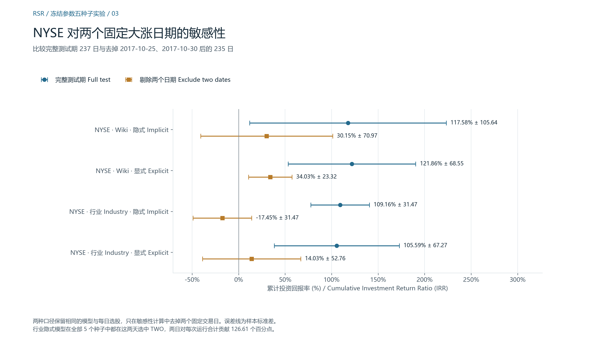

# 研究笔记 · 面向股票预测的时序关系排序

[English](RESEARCH_NOTE.md) · [项目首页](../README.zh-CN.md) · [证据索引](README.md)

Fuli Feng、Xiangnan He、Xiang Wang、Cheng Luo、Yiqun Liu 和 Tat-Seng Chua 提出关系股票排序（RSR）和时序图卷积（TGC），并在 *ACM Transactions on Information Systems* 37(2), Article 27（2019）发表原始实验。下文公式和章节编号按 arXiv v2。复现证据来自固定版本的作者实现、本地 TensorFlow 适配和实验记录。 [期刊论文](https://doi.org/10.1145/3309547) · [arXiv v2](https://arxiv.org/abs/1809.09441v2) · [作者固定提交](https://github.com/fulifeng/Temporal_Relational_Stock_Ranking/tree/cfbb01bdf194b81bc5893a1b37aff1c0d0d2a82d)

## 1. 研究动机与问题定义

在交易日 $t$ 收盘时，模型要为 $N$ 只股票的下一交易日收益排序。设收盘价为 $p_{i,t}$，标签为 $r_{i,t+1}=(p_{i,t+1}-p_{i,t})/p_{i,t}$。同一数值既是回归目标，也决定当日横截面的真实排序。即使所有股票上的平均误差很小，预测收益率相近时，微小扰动也可能改变第一名。排序项直接约束相对次序，回归项则把分数约束在收益率的数值尺度上。

独立时序模型可以利用各股票自身的历史。同行业或业务联系让另一家企业的当期状态也可能提供信息。基准实验考察引入这些联系能否改善排序。即使关系图固定，同一条边在不同日期也可以有不同权重。 [论文第 1、3 节](https://arxiv.org/abs/1809.09441v2)

## 2. 模型结构与数学理解

### 价格窗口与时序编码

第 $i$ 只股票的输入是截至 $t$ 日最近 $S$ 个交易日的特征。每天有 $D=5$ 维，依次为 MA5、MA10、MA20、MA30 和收盘价。预处理在各回看窗口内使用可用收盘价计算均值。五列共享该股票的价格缩放常数，因此它在收益率的分子与分母中会抵消，但仍改变网络所见的特征数值。CSV 的日期索引列不作为输入特征。

LSTM 的隐藏维度为 $U$，在股票之间共享参数，每个窗口的隐藏状态和记忆状态都从零开始。在窗口第 $s$ 步，当前输入与上一步隐藏状态拼成 $\mathbb R^{D+U}$ 中的向量。可学习的仿射变换输出四个 $U$ 维分量。输入门 $i_s$、遗忘门 $f_s$、输出门 $o_s$ 经 sigmoid，候选状态 $g_s$ 经 tanh。用 $\odot$ 表示逐元素乘法，有

$$
c_s=f_s\odot c_{s-1}+i_s\odot g_s,\qquad h_s=o_s\odot\tanh(c_s).
$$

兼容实现的单元在遗忘门的 sigmoid 前额外加 1。最后一步的隐藏状态 $e_i=h_S$ 代表第 $i$ 只股票。对所有股票堆叠得到 $X_t\in\mathbb R^{N\times S\times 5}\rightarrow E_t\in\mathbb R^{N\times U}$。 [论文式 (7) 与第 4.1 节](https://arxiv.org/abs/1809.09441v2) · [编码器](../compat/training/rank_lstm.py) · [前向校验](../compat/verify_forward.py)

### 时序图卷积

设 $a_{ij}\in\{0,1\}^K$ 是**代码**中含 $K$ 个关系通道的张量 $A\in\{0,1\}^{N\times N\times K}$ 第 $i$ 行、第 $j$ 列的多热切片。行业边记录共同的行业归属。Wikidata 边记录直接联系及部分经共享实体形成的路径。保存的图包含自环，例如 NASDAQ Wikidata 有 $K=43$ 个通道，含自环。论文用 $a_{ji}$ 表示从 $j$ 向 $i$ 传播时使用的关系，并在传播中引入 $1/d_j$，其中 $d_j$ 是其定义下的邻居数。式 (12) 将嵌入内积乘以经激活的关系投影。式 (13) 对两端嵌入与关系向量的拼接做一次仿射变换和激活。 [论文式 (9)–(13) 与第 4.2 节](https://arxiv.org/abs/1809.09441v2) · [关系张量核验](../audit/author-data-verification.json)

发布代码与兼容实现采用下列分数，省略时间下标。设 $\phi$ 为负半轴斜率 0.2 的 Leaky ReLU，定义 $q_{ij}=\phi(w_a^\top a_{ij}+b_a)$、$u_i=\phi(w_h^\top e_i+b_h)$、$v_j=\phi(w_v^\top e_j+b_v)$，其中 $w_a\in\mathbb R^K$、$w_h,w_v\in\mathbb R^U$，偏置均为标量。则

$$
z^{\mathrm E}_{ij}=(e_i^\top e_j)q_{ij},\qquad
z^{\mathrm I}_{ij}=u_i+v_j+q_{ij}.
$$

RSR_I 对三项投影分别做激活。两种实现都加图掩码 $B_{ij}$，有边处为 0，无边处为 $-10^9$，随后**沿列归一化**（第 0 轴 softmax）：

$$
P_{ij}=\frac{\exp(z_{ij}+B_{ij})}{\sum_{\ell=1}^{N}\exp(z_{\ell j}+B_{\ell j})},
\qquad \widetilde E=PE_t.
$$

有限掩码在 FP32 下压低无边项。$P\in\mathbb R^{N\times N}$ 的各列和为 1，各行和可以不同。矩阵乘法在 $\widetilde E\in\mathbb R^{N\times U}$ 的每一行上形成对 $e_j$ 的加权和。代码使用上述归一化，未另做论文传播式里的度数除法。 [固定上游关系代码](https://github.com/fulifeng/Temporal_Relational_Stock_Ranking/blob/cfbb01bdf194b81bc5893a1b37aff1c0d0d2a82d/training/relation_rank_lstm.py#L121-L160) · [兼容实现](../compat/training/relation_rank_lstm.py#L121-L160)

沿归一化轴检查会发现，固定 $j$ 时，隐式分数的整列共享同一个 $v_j$。在精确算术中，分子与分母的 $\exp(v_j)$ 约去。因此在这一代数模型中，即使计算图将尾节点投影声明为可训练，其取值也不影响 $P$。头节点项与关系项仍可沿列变化。这是对发布实现的推导。现有实验没有用消融估计该计算特征对结果的影响。

### 预测、损失与梯度

实际配置拼接 $e_i$ 和 $\widetilde e_i$ 得到 $h_i=[e_i;\widetilde e_i]\in\mathbb R^{2U}$。全连接层使用 $w_p\in\mathbb R^{2U}$ 和标量偏置 $b_p$，得到归一化价格预测 $\widehat p_{i,t+1}=\phi(w_p^\top h_i+b_p)$。再以同尺度收盘价计算 $\widehat r_i=(\widehat p_{i,t+1}-p_{i,t})/p_{i,t}$。以 NASDAQ Wikidata 的 $(S,U)=(8,64)$ 为例，输入形状为 $1026\times8\times5$，拼接后为 $1026\times128$，收益率输出为 $1026\times1$。Rank_LSTM 的预测头只使用 $e_i$。 [预测与损失实现](../compat/training/relation_rank_lstm.py#L141-L187)

设 $m_i\in\{0,1\}$ 表示含目标日的窗口内收盘价有效，$r_i$ 为真实次日收益率。当某市场日批次有有效股票时，代码的损失为

$$
\mathcal L=
\frac{\sum_i m_i(\widehat r_i-r_i)^2}{\sum_i m_i}
+\frac{\alpha}{N^2}\sum_{i,j} m_i m_j
\max\bigl(0,-(\widehat r_i-\widehat r_j)(r_i-r_j)\bigr).
$$

论文式 (8) 表达了不含掩码的目标。实现用有效股票数归一化回归项，用全部有序对数归一化排序项，后者包含贡献为零的股票对。有效且排序颠倒的股票对会产生与真实收益差成比例的梯度，将真实收益较高的股票向上推。预测分数相等时该对的排序损失为零，若个别预测与真实值不同，回归项仍提供梯度。

Adam 通过收益率转换与预测头反向传播。RSR 阶段的梯度还经过传播和与损失相连的关系评分参数。编码器阶段的梯度更新 Rank_LSTM 的预测头与递归参数。RSR 在独立阶段接收预先计算的固定 $E_t$，因此其损失不会反传到 LSTM，$A$ 也始终是固定输入。 [论文式 (8)](https://arxiv.org/abs/1809.09441v2) · [Rank_LSTM 训练](../compat/training/rank_lstm.py) · [搜索训练实现](../experiments/search_training.py)

## 3. 复现设计

本项目将作者 TensorFlow 1 时代的代码适配到 WSL2 上的 TensorFlow 2.21 图模式，保留发布版评分和损失，将大型关系张量存入不可训练缓冲区。前向记录用独立的 NumPy 计算校验合成输入。作者数据有 NASDAQ 1,026 只和 NYSE 1,737 只股票。训练／验证／测试依次为 756／252／237 日，对应 2013–2015 年、2016 年及 2017 年截至 12 月 8 日。两个市场均运行两类图与两种建模形式。 [兼容说明](../compat/README.md) · [前向核验](../audit/compat-forward.json) · [数据核验](../audit/author-data-verification.json)

- **A · 作者公开流程。** 八次 RSR 训练使用固定的作者嵌入、全期价格归一化与公开关系训练种子 123456789。作者 README 给出的 $(S,U,\alpha)$ 是 NASDAQ Wikidata RSR_I 的 $(16,64,0.1)$ 和 NYSE Industry RSR_I 的 $(8,32,10)$。其余六组沿用各自市场的模板。论文对应的六组具体设置、作者完整种子和预训练种子仍不明确。 [实验清单](../experiments/manifest.json) · [预检](../audit/experiment-preflight.json)
- **B · 独立协议。** 用每只股票在公开尺度上的训练期最高有效收盘价作分母，将该股票的公开价格特征重新缩放，只使用目标索引 16–755（各配置共用 740 日）训练，保留作者股票池与关系图。每次固定另两项为市场基线，分别搜索 $S\in\{2,4,8,16\}$、$U\in\{16,32,64,128\}$ 和 $\alpha\in\{0.1,1,10\}$。86 次搜索训练含 14 次编码器和 72 次 RSR 训练。另验证六个单因素优胜值组合，需 4 次编码器和 6 次 RSR 训练。每次选最低验证总损失的检查点，再按该点的验证 IRR 比较配置，指标相同则依次看更高的 MRR 和更低的 MSE。 [搜索记录](../runs/hparam-search-summary.json) · [组合记录](../runs/hparam-combination-summary.json)

两套协议均为一步预测、50 轮、Adam 学习率 0.001。B 阶段编码器排序权重为 1。选参后冻结八组配置并在测试期做推理。随后使用 175185289、425827170、1846380228、1772992330 和 20885008 重训两个阶段。相同市场、$S$、$U$ 与种子的模型复用编码器，共需 30 次编码器和 40 次 RSR 训练。历史种子 123456789 不计入五种子统计。总计 174 次训练。本地分析从保存的预测、标签和掩码重算指标，五种子 RSR 核验覆盖 80 个验证和测试分区。 [冻结清单](../runs/frozen-test-manifest.json) · [五种子计划](../runs/multiseed-plan.json) · [指标核验](../tools/analyze_multiseed.py)

## 4. 结果与解释

MSE（均方误差）衡量有效股票日上收益率预测的平方误差均值。若第 $t$ 日有效股票中预测分数最高者的真实排名为 $k_t$，MRR（平均倒数排名）就是对 $1/k_t$ 跨日取均值。IRR（累计投资回报率）将每日首选股票的真实简单收益率求和。评估器保存的 btl 在这项和上加 1，文中百分数用 $100(\mathrm{btl}-1)$。某日被选股票的大幅收益可以显著改变 IRR，但只占总体 MSE 中很小的一部分。 [论文第 5.1.1 节](https://arxiv.org/abs/1809.09441v2) · [评估器](../compat/training/evaluator.py)

**协议 A。** 每行用一次本地训练与论文五次运行的均值对照。

| README 配置 | 测试 MSE（×10⁻⁴），论文 → 本地 | 测试 MRR，论文 → 本地 | 测试 IRR，论文 → 本地 |
| --- | ---: | ---: | ---: |
| NASDAQ Wikidata RSR_I（表 7） | 3.7900 → 3.7930 | 0.04090 → 0.03864 | 119% → 95.65% |
| NYSE Industry RSR_I（表 6） | 2.2600 → 2.2672 | 0.04510 → 0.04630 | 106% → 147.79% |

八组的测试 MSE 相对偏差最大为 3.23%。两组 README 配置的 IRR 分别相差 −23.35 和 +41.79 个百分点，说明 MSE 接近仍不足以复现选股回报。结合公开配置、种子和各项指标，当前结论为**部分数值复现**。 [八组对照](../audit/public-seed-comparison.json) · [对照图](../figures/public-seed/01-test-metrics.png)

**协议 B。** 按既定检查点规则，六个新组合的验证 IRR 都未超过此前已观测的最优配置。本次搜索中，单因素的优胜值拼在一起未带来更好的联合配置。历史种子在八组中的测试 IRR 均低于对应验证 IRR，测试中七组为正。验证期参与了选参，两段样本的长度和收益路径也不同，单凭差值无法分辨选参的影响。 [组合结果](../runs/hparam-combination-summary.json) · [冻结测试](../runs/frozen-test/analysis.json)

| 市场 | 关系图 | 建模 | $(S,U,\alpha)$ | 测试 IRR 均值（%） | 样本标准差（百分点） |
| --- | --- | --- | --- | ---: | ---: |
| NASDAQ | Wikidata | RSR_I | (8, 64, 0.1) | 54.54 | 66.47 |
| NASDAQ | Wikidata | RSR_E | (8, 64, 0.1) | 42.94 | 45.40 |
| NASDAQ | Industry | RSR_I | (16, 64, 10) | 22.04 | 30.93 |
| NASDAQ | Industry | RSR_E | (16, 16, 0.1) | 24.87 | 96.01 |
| NYSE | Wikidata | RSR_I | (16, 32, 10) | 117.58 | 105.64 |
| NYSE | Wikidata | RSR_E | (8, 32, 1) | 121.86 | 68.55 |
| NYSE | Industry | RSR_I | (4, 32, 10) | 109.16 | 31.47 |
| NYSE | Industry | RSR_E | (16, 32, 10) | 105.59 | 67.27 |

NYSE 各组的平均 IRR 高于对应的 NASDAQ 组，20 次 NYSE 测试均为正。NASDAQ 有 16 次为正，种子 1846380228 在四组中均为负。NASDAQ Industry RSR_E 的范围为 −114.10% 至 156.15%。样本标准差（ddof = 1）描述同一测试期上不同种子的波动。按种子配对，RSR_I 胜过 RSR_E 的次数在 NASDAQ 的 Wikidata 与 Industry 上分别为 3/5、2/5，在 NYSE 两类图上均为 3/5。配对比较的是选参后的流程，部分配对在超参数和编码器上也有差别，因此对评分形式本身的解释有限。 [逐种子结果和配对](../runs/multiseed-analysis.json) · [测试指标图](../figures/multiseed/01-test-metrics-mean-std.png)

NYSE Industry RSR_I 的五次运行都在 2017 年 10 月 25 日、30 日选中 TWO。记录的两日收益为 62.65%、63.96%。保持原每日选股，剔除这两日会使每次 IRR 下降 126.61 个百分点，均值从 109.16% 降至 −17.45%，样本标准差仍为 31.47 个百分点。该事后计算衡量记录中的收益集中程度。异常收益原因仍待核验，要区分价格真实波动、公司行动、复权影响和数据问题，需要按日期核对原始与复权价格、代码沿革及公司行动记录。 [每日选股与敏感性分析](../runs/multiseed-analysis.json)

## 5. 方法局限

发布版先打乱偏移 0–755，再截取 $756-S$ 个。一步预测的标签索引为偏移 $+S$，所以末尾 $S$ 个偏移可能触及验证期。预检在 NASDAQ 与 NYSE 设置的 50 轮中分别记录到 781 和 393 次这样的抽样，次数包含窗口的重复抽取。全期归一化也会把后续价格纳入特征尺度。协议 B 改变了这两项处理，回答的是另一项实验问题。 [采样预检](../audit/experiment-preflight.json) · [训练数据与偏移](../experiments/search_training.py)

两套协议都保留了按全期覆盖率和最低价格筛选的股票池，入选依赖后续观察。Wikidata 图来自 2018 年快照，两套图均未按历史决策日期重建。评估掩码还检查目标日，因此首选股票是在有目标记录的股票中选出。若要评估可部署策略，需要按下单时已知的信息确定可选股票和企业关系。 [论文第 4 节](https://arxiv.org/abs/1809.09441v2) · [批次掩码](../compat/training/relation_rank_lstm.py#L75-L89)

IRR 按每日等额名义本金的简单收益累加，可以低于 −100%。这些测试期统计无法确立可实现的交易盈利能力。模拟假设按收盘价成交，未计交易成本、滑点、流动性与资金约束。五个种子共享同一个测试期，尚未衡量跨时期泛化。论文的完整基线、关系消融及不同持仓规模也仍待比较。 [详细结果与覆盖范围](EXPERIMENT_RESULTS.md)

## 6. 复现所得与待验证问题

沿时间索引从窗口追踪到标签，可以看出数据按时间切分后，采样偏移仍可能跨过边界。沿股票索引检查 softmax，可以解释为何图中标记为可训练的一项会被归一化消掉。合读三种指标能区分收益预测精度、实际名次和选股回报。在同一组测试日期上更换种子测量的是对初始化的敏感性，对市场历史样本的敏感性仍需另行检验。

以下是后续可检验的研究问题：

1. 固定切分、种子、编码器设置及选择规则后，TGC 能否比匹配的 Rank_LSTM 提供增量价值？
2. 保持其余流程一致，经济关系图是否优于度数匹配的随机图或股票标签置换图？
3. 在嵌入、$S$、$U$、$\alpha$ 和日期相同的情况下，RSR_I 与 RSR_E 有何差异？可用控制变量的消融区分评分形式和选参影响。
4. 在按历史可用信息确定的股票池、独立核验的收益和明确的成交成本下，改变特征或带日期的关系类型能否在多个滚动窗口中改善排序？

[实验记录](EXPERIMENT_RESULTS.md) · [数据和产物](DATA_AND_ARTIFACTS.md) · [原论文引用](../CITATION.bib)
